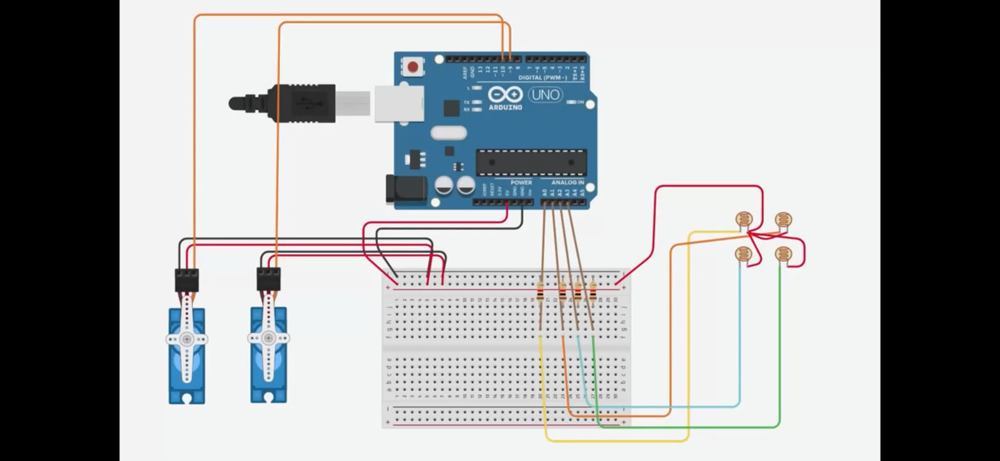

# Rastreador Solar — PIM UNIP

Protótipo de **rastreador solar de dois eixos**: um Arduino Nano, quatro LDRs e dois servos MG996R
mantêm um painel solar de 10 W apontado para a luz, aumentando o aproveitamento de energia. O
sistema é alimentado por uma bateria de 12 V com conversores XL4015.



*O Tinkercad não tem Arduino Nano; o diagrama usa um UNO, que tem o mesmo microcontrolador e os
mesmos pinos.* Lista de materiais e alimentação: [02-hardware.md](docs/specs/02-hardware.md).

## Conteúdo

| Pasta/arquivo | Descrição |
|---------------|-----------|
| `main.c` | Firmware do Arduino |
| `docs/specs/` | Especificações (requisitos, hardware, firmware, mecânica, testes) |
| `3d_material/` | Peças para impressão 3D (`stl/`) e montagem completa (`amf/`) |
| `simulator/` | Simulador 3D no navegador: o firmware real roda emulado sobre as peças 3D |

## Simulador 3D

Teste o código sem hardware: mova o sol e veja a estrutura seguir a luz, com leituras dos LDRs,
monitor serial e comparação de energia com uma placa fixa.

```bash
python3 -m http.server 8000   # na raiz do repositório
```

Abra http://localhost:8000/simulator/ — detalhes em [simulator/README.md](simulator/README.md).

## Como funciona

Os quatro LDRs ficam em cruz, separados por um anteparo. Quando a luz vem de um lado, o anteparo
sombreia os sensores do lado oposto; o Arduino compara as médias (esquerda × direita,
superior × inferior) e gira cada servo alguns graus na direção da luz até equilibrar.

Detalhes em [docs/specs/01-visao-geral.md](docs/specs/01-visao-geral.md).

## Executar

1. Ajustar os XL4015 com multímetro **antes** de ligar as cargas (6,0 V servos, 7,5 V Nano).
2. Montar o circuito (pinos e alimentação em [02-hardware.md](docs/specs/02-hardware.md)).
3. Abrir o código na Arduino IDE — placa **Arduino Nano**, processador **ATmega328P (Old
   Bootloader)** na maioria dos clones — e enviar.
4. Abrir o Monitor Serial a 9600 baud para ver as leituras.
